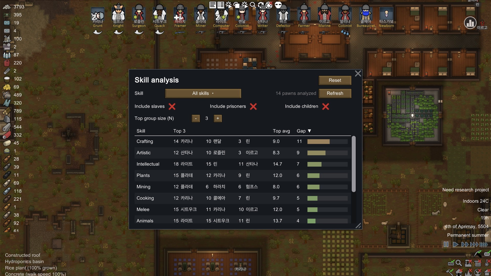
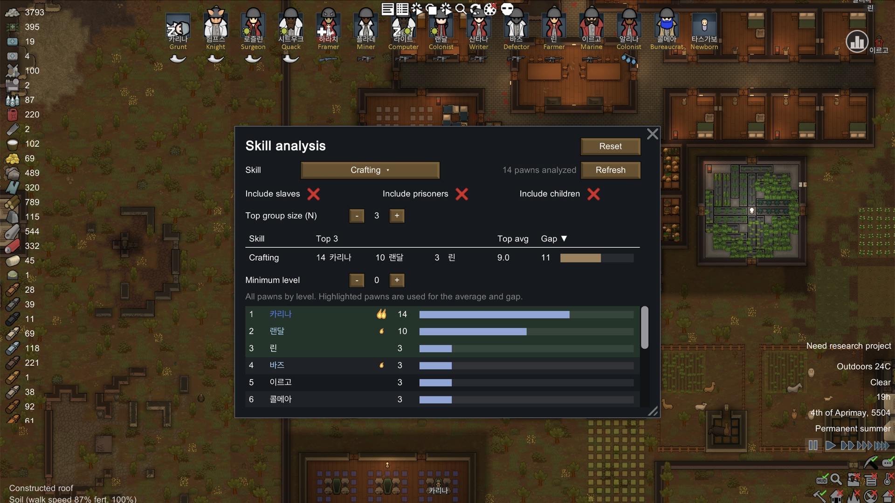

# RimWorld Skill Gap Analyzer

A RimWorld mod that analyzes your colonists' skills. As you recruit more and more colonists, it gets hard to tell which skills you are short on. You may have plenty of colonists but only one who is good at a certain skill, and if that colonist goes down or is away, nobody can do that work. This mod helps you catch that early. See the gap in skill level between your top N colonists and the average level at a glance, or check every colonist's level for a single skill as a ranking.



## Features

- **Per-skill table**: Lowest, highest, top-N average and gap for every skill. Modded skills are included automatically.
- **Single skill view**: Pick one skill from the dropdown to see every pawn ranked by level, with the top-N pawns highlighted. Click a pawn to jump to them.
- **Top-N focus**: Only your best N pawns matter for a skill, so a low top-N average means the colony is weak at it, and a big gap means the best pawns are far apart in level.
- **Who is counted**: Free colonists, plus optional slaves, prisoners and children. Babies are always left out, and pawns who can never do a skill are ignored for it.
- **Floating button or hotkey**: Open the window from a small icon button you can drag anywhere (top right by default), or switch to a keyboard shortcut in the mod settings. No key is assigned by default; set one in Options > Keyboard config.
- **Remembers your choices**: Filters, N, the selected skill and the button position are saved. The Reset button in the window restores the default view.



## Requirements

- RimWorld **1.7** (Waylith Engine, currently on the Steam unstable beta branch)
- No other mods required. Skill Gap Analyzer only reads game data and does not patch game code, so it does not need Harmony.

## Tech Stack

| Area | Technology |
|---|---|
| Language | C# (latest), XML |
| Runtime | .NET 10 (`net10.0`), matching RimWorld 1.7's runtime |
| Build | .NET 10 SDK (`dotnet build`) |
| Game APIs | `Assembly-CSharp.dll` (Verse / RimWorld), `UnityStubs.dll` (Unity types such as `Rect` and `Vector2`) |

How it works:
- **Data source**: Reads the skills (`SkillDef`) loaded in the game and each pawn's `SkillRecord`, so modded skills are included automatically.
- **Settings**: A `ModSettings` class saves the filters, N, the selected skill and the button position.
- **UI**: An analysis `Window` plus a draggable floating button `Window`. The optional hotkey is a `KeyBindingDef` checked by a `GameComponent`.

## Project Structure

```
About/About.xml                Mod metadata
Defs/                          Key binding definition
Languages/                     English and Korean translations
Textures/                      Mod icon (floating button)
Source/SkillGapAnalyzer/       C# project
Assemblies/                    Build output (SkillGapAnalyzer.dll, not committed)
scripts/package.sh             Builds a clean copy for Steam Workshop upload
docs/screenshots/              Screenshots
```

## Building

1. Install the [.NET 10 SDK](https://dotnet.microsoft.com/download/dotnet/10.0).
2. Build:
   ```sh
   cd Source/SkillGapAnalyzer
   dotnet build -c Release
   ```
   By default the project references the game at `~/Library/Application Support/Steam/steamapps/common/RimWorld` (macOS Steam). Use a different install with `-p:RimWorldDir=/path/to/RimWorld`.
3. Link the repository into the game's `Mods` folder:
   ```sh
   ln -s "$(pwd)/../.." ~/Library/Application\ Support/Steam/steamapps/common/RimWorld/Mods/SkillGapAnalyzer
   ```

## Installation

Subscribe on the Steam Workshop.

## Development

This mod was written with [Claude Code](https://claude.com/claude-code), Anthropic's AI coding assistant.

## License

This project is licensed under the [MIT License](LICENSE).

---

# 림월드 스킬 격차 분석기

림월드에서 정착민들의 스킬을 분석해 주는 모드입니다. 게임을 진행하며 정착민을 여러 명 영입하다 보면, 어떤 스킬을 가진 정착민이 부족한지 헷갈릴 때가 있습니다. 정착민은 많은데 특정 스킬을 잘하는 정착민이 한 명뿐이라면, 그 정착민이 쓰러지거나 자리를 비웠을 때 해당 작업을 할 수 없게 될 수도 있습니다. 이 모드로 그런 상황을 미리 막을 수 있습니다. 상위 N명 사이의 스킬 레벨 격차와 평균 레벨을 바로 확인할 수 있고, 스킬별로 모든 정착민의 레벨을 순위로 볼 수도 있습니다.


## 주요 기능

- **스킬별 표**: 모든 스킬의 최저, 최고, 상위 N명 평균, 격차를 보여줍니다. 모드 스킬도 자동으로 포함됩니다.
- **스킬 하나만 보기**: 드롭다운에서 스킬을 고르면 모든 정착민을 레벨 순으로 보여 주고, 상위 N명을 강조합니다. 이름을 누르면 해당 정착민으로 이동합니다.
- **상위 N명 중심**: 스킬은 가장 잘하는 N명만 중요하므로, 상위 N명 평균이 낮으면 콜로니가 그 스킬에 약하다는 뜻이고 격차가 크면 상위 정착민끼리 레벨 차이가 크다는 뜻입니다.
- **집계 대상**: 자유 정착민이 기본이고, 노예, 죄수, 아이를 선택해서 포함할 수 있습니다. 아기는 항상 제외되고, 해당 스킬을 아예 못 하는 정착민은 그 스킬에서 빠집니다.
- **아이콘 버튼 또는 단축키**: 원하는 곳으로 옮길 수 있는 작은 아이콘 버튼(기본 위치는 오른쪽 위)으로 열거나, 모드 설정에서 키보드 단축키로 바꿀 수 있습니다. 기본 단축키는 없고, 옵션 > 키보드 설정에서 직접 지정합니다.
- **설정 기억**: 필터, N, 선택한 스킬, 버튼 위치가 저장됩니다. 창의 초기화 버튼으로 기본 화면으로 되돌릴 수 있습니다.


## 요구 사항

- 림월드 **1.7** (Waylith Engine, 현재 Steam unstable 베타 브랜치)
- 다른 모드는 필요하지 않습니다. 게임 데이터를 읽기만 하고 게임 코드를 수정하지 않기 때문에 Harmony도 필요 없습니다.

## 기술 스택

| 분야 | 기술 |
|---|---|
| 언어 | C# (최신 버전), XML |
| 런타임 | .NET 10 (`net10.0`), 림월드 1.7 런타임과 동일 |
| 빌드 | .NET 10 SDK (`dotnet build`) |
| 게임 API | `Assembly-CSharp.dll` (Verse / RimWorld), `UnityStubs.dll` (`Rect`, `Vector2` 같은 Unity 타입) |

동작 방식:
- **데이터 출처**: 게임에 로드된 스킬(`SkillDef`)과 각 정착민의 `SkillRecord`를 읽습니다. 그래서 모드 스킬도 자동으로 반영됩니다.
- **설정 저장**: `ModSettings` 클래스가 필터, N, 선택한 스킬, 버튼 위치를 저장합니다.
- **UI**: 분석 `Window`와 드래그할 수 있는 아이콘 버튼 `Window`로 구성됩니다. 선택 사항인 단축키는 `KeyBindingDef`이고, `GameComponent`가 입력을 확인합니다.

## 프로젝트 구조

```
About/About.xml                모드 정보
Defs/                          키 바인딩 정의
Languages/                     영어, 한국어 번역
Textures/                      모드 아이콘 (아이콘 버튼)
Source/SkillGapAnalyzer/       C# 프로젝트
Assemblies/                    빌드 결과물 (SkillGapAnalyzer.dll, 커밋하지 않음)
scripts/package.sh             Steam 창작마당 업로드용 폴더를 만드는 스크립트
docs/screenshots/              스크린샷
```

## 빌드 방법

1. [.NET 10 SDK](https://dotnet.microsoft.com/download/dotnet/10.0)를 설치합니다.
2. 빌드합니다.
   ```sh
   cd Source/SkillGapAnalyzer
   dotnet build -c Release
   ```
   기본적으로 `~/Library/Application Support/Steam/steamapps/common/RimWorld`(macOS Steam)에 있는 게임을 참조합니다. 다른 경로에 설치했다면 `-p:RimWorldDir=/path/to/RimWorld`로 지정합니다.
3. 저장소를 게임의 `Mods` 폴더에 링크합니다.
   ```sh
   ln -s "$(pwd)/../.." ~/Library/Application\ Support/Steam/steamapps/common/RimWorld/Mods/SkillGapAnalyzer
   ```

## 설치 방법

Steam 창작마당에서 구독하세요.

## 개발

이 모드는 Anthropic의 AI 코딩 도구인 [Claude Code](https://claude.com/claude-code)로 개발되었습니다.

## 라이선스

이 프로젝트는 [MIT 라이선스](LICENSE)를 따릅니다.
